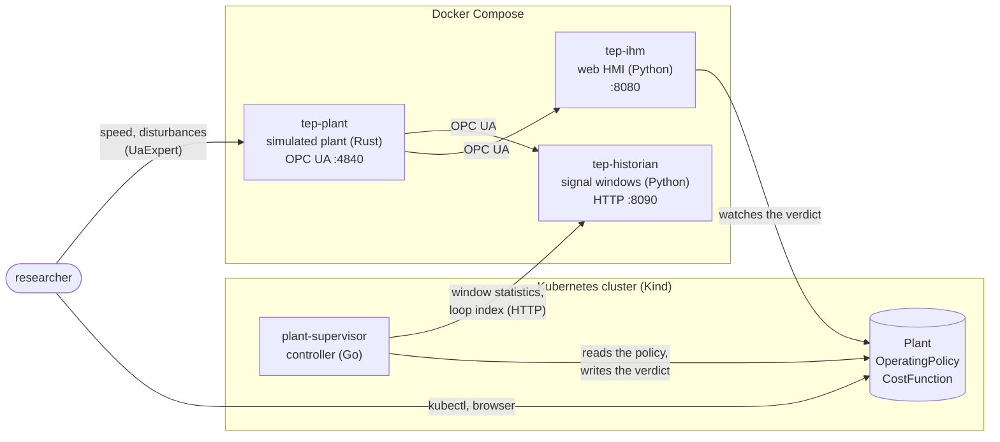

# Supervising the Tennessee Eastman process with Kubernetes

Can Kubernetes act as the supervisory layer of a process plant? This project builds one and tries it. A simulated chemical plant runs continuously and publishes its signals over OPC UA; a controller inside a Kubernetes cluster watches it and decides, every 30 seconds, whether the plant complies with an operating policy that the user declares as Kubernetes resources: the operating cost, the production targets, the operating limits and the control loops that must stay healthy. The supervisor knows nothing about the plant beyond what the policy says, and it only observes: it never writes to the plant.

The plant is the Tennessee Eastman process (TEP), the benchmark published by Downs and Vogel (1993), rewritten in Rust from the original FORTRAN.

This is a bachelor's thesis in Control and Automation Engineering at the Instituto Federal do Espírito Santo (IFES), by Matheus Corteletti Delfino: *Supervisão Declarativa do Processo Tennessee Eastman com Kubernetes: Função de Custo e Qualidade de Malhas sobre uma Planta Simulada em OPC UA* (2026). The text, in Portuguese, is in [`tep-monografia`](https://github.com/Batchuka/tep-monografia).

This repository is the entry point. It holds no code: it holds the experiment log, the design notes and the issues that span the other repositories.

## How it fits together



1. `tep-plant` integrates the model continuously and exposes every sensor, valve, disturbance switch and the simulated clock as OPC UA nodes. Its three regulatory loops (reactor pressure, separator level, stripper level) run inside it.
2. `tep-historian` reads all signals every 100 ms, keeps the last 15 minutes and answers two questions over HTTP: statistics of a set of signals over a window, and a quality index for each control loop (the predictability index of Bradu et al., used at CERN).
3. `plant-supervisor` reads the active `OperatingPolicy` and its `CostFunction`, asks the historian for exactly the signals they mention, computes the cost J, checks targets, limits and loops, and writes the verdict (`Compliant`, `NonCompliant` or `Pending`, plus one condition per check) into the `Plant` status.
4. `tep-ihm` draws the process diagram live in the browser and shows the verdict, which it reads from Kubernetes, not from the supervisor.

Everything specific to the TEP lives in three YAML manifests in [`tep-lab/local/k8s/tep/`](https://github.com/Green-Cinnamon-Labs/tep-lab/tree/main/local/k8s/tep): the cost function of Downs and Vogel (Table 9), the Mode 1 policy and the plant. The supervisor's Go code has nothing about the TEP.

## Repositories

| Repository | What it is | Version used in the thesis |
|---|---|---|
| [`tep-plant`](https://github.com/Green-Cinnamon-Labs/tep-plant) | The TEP model in Rust: five process units, three control loops, 41 noisy measurements, 12 valves, 5 of the 20 disturbances, served over OPC UA. | `v2.0.0` (proportional loops) |
| [`monjolo`](https://github.com/Green-Cinnamon-Labs/monjolo) | The Rust framework under the plant: named state registry, RK4 integration, evaluation order inferred from what each task reads and writes, OPC UA adapter. Knows nothing about the TEP. | `v1.1.0` |
| [`tep-historian`](https://github.com/Green-Cinnamon-Labs/tep-historian) | Generic OPC UA collector with window statistics and the loop-quality index over HTTP. | `v1.0.0` |
| [`plant-supervisor`](https://github.com/Green-Cinnamon-Labs/plant-supervisor) | The Kubernetes controller (Go, Kubebuilder) and its three resources: `Plant`, `OperatingPolicy`, `CostFunction`. Plant-agnostic. | `v1.0.0` |
| [`tep-ihm`](https://github.com/Green-Cinnamon-Labs/tep-ihm) | Web HMI: the process diagram animated live, the supervisor's verdict, capture sessions. | `v1.2.0` |
| [`tep-lab`](https://github.com/Green-Cinnamon-Labs/tep-lab) | How to run all of it: Docker Compose and Kind, the TEP manifests, the experiment recordings and the analysis scripts. | `v1.0.0` |
| [`tep-optimizer`](https://github.com/Green-Cinnamon-Labs/tep-optimizer) | Parallel line: a steady-state optimizer that calls the plant as a function over HTTP. | `v0.1.0` |

Two later versions of the plant matter for the results: `tep-plant v2.1.0-alpha` has proportional-integral loops (Experiment 27), and `v2.2.0-alpha` integrates the cooling water again and adds the function mode used by the optimizer. The `main` branch of `tep-plant` is on the PI line, which loses the plant after about 33 simulated hours; the stable plant is `v2.0.0`.

## What came out of it

- **The plant matches the original model.** At the Downs and Vogel base case, all derivatives are close to zero and the 41 measurements and the operating cost match the published values (170.63 against 170.61 $/h). With the cooling water integrated, the optimizer finds the Mode 1 optimum published by Ricker (1995): 114.32 against 114.31 $/h, with the 12 valves within 0.001 percentage points.
- **The verdict follows the plant under a fixed policy.** In normal operation the plant stays `Compliant` (J ≈ 166.8 $/h). After losing the A feed (disturbance IDV(6)), the verdict turns `NonCompliant` 1.15 h of process time later, in the physical order of events (product flow first, cost second), and stays so while the plant does not recover.
- **A loop-quality index alone is not enough.** The predictability index read the pressure loop as healthy while the pressure was 131 kPa above its setpoint: under a disturbance the error becomes a slow, predictable drift. Adding a setpoint-tracking criterion to the policy made the loops raise the alarm before the economic verdict (Experiment 26).
- **Cost can improve while the plant degrades.** With proportional-integral loops and no reactor level loop, the plant drifted for 30 hours without any disturbance and was lost; the cost fell the whole time, from 166 to 55 $/h, and only the reactor level limit in the policy noticed, late (Experiment 27). A useful policy also needs limits on inventories without a loop and some test for trends.

The thesis discusses each of these in its results chapter. The full trail, including what did not work, is in the experiment log.

## Running it

You need Docker Desktop, [Kind](https://kind.sigs.k8s.io/) and `kubectl`. From [`tep-lab/local/`](https://github.com/Green-Cinnamon-Labs/tep-lab/tree/main/local):

```bash
bash build-images.sh    # the four images, built from the release tags
docker compose up -d    # plant, historian and HMI
bash setup.sh           # Kind cluster, supervisor and the TEP manifests
kubectl get plants
```

The HMI is at http://localhost:8080. Details, including how to connect UaExpert and how to trigger a disturbance, are in the [`tep-lab` README](https://github.com/Green-Cinnamon-Labs/tep-lab).

## In this repository

- [`experimentos.md`](experimentos.md): the experiment log, in Portuguese, newest first. Each entry follows Observation → Hypothesis → Intervention → Result → Conclusion; an index at the top summarizes all 27.
- [`docs/`](docs/README.md): design notes, one folder per issue.
- [`CONTRIBUTING.md`](CONTRIBUTING.md): the architecture decisions of `tep-plant` and `monjolo`, as numbered articles.
- [Issues](https://github.com/Green-Cinnamon-Labs/spec-tennessee-eastman/issues): open work for all repositories is tracked here, with the target repository in brackets in the title.

## Known limitations

- The supervisor only observes. Acting on the plant (writing setpoints or switching policy when the verdict changes) is future work.
- In the versions used with the supervisor, the cooling-water outlet temperatures are constant, so the cooling-water valves and the disturbances that act on them have no effect. Only 5 of the 20 disturbances exist (IDV 1, 2, 3, 6 and 7), and the composition analyzers are continuous instead of sampled.
- The HMI's command buttons no longer reach the plant; speed and disturbances are set over OPC UA with a generic client such as UaExpert.
- The loop-quality index in the code uses the scale opposite to the formula in the article; the thesis re-reads the recorded data on the article's scale.
